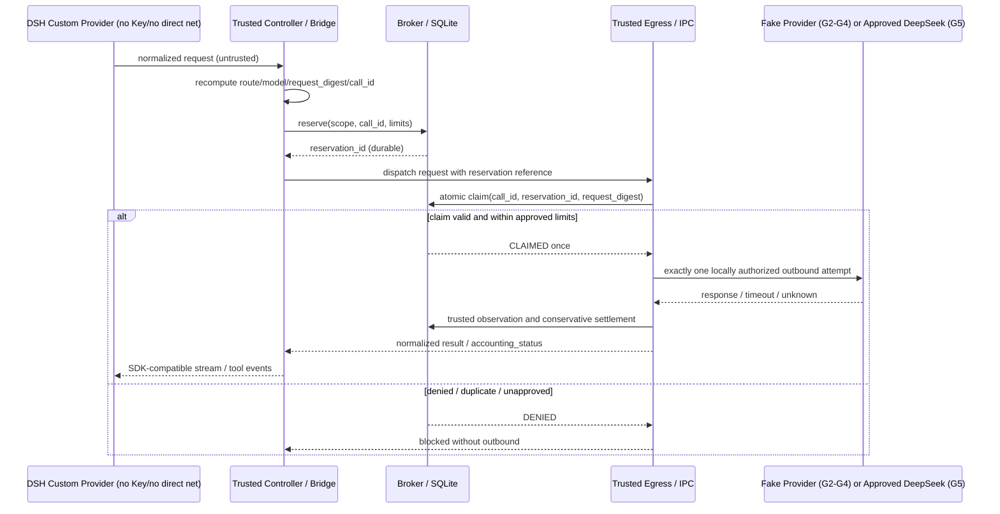

# Autonomous Teacher — M0 收尾实施、验收与独立审阅手册

> **版本**：v0.6（实施与审阅用任务书）  
> **编制日期**：2026-11-15  
> **适用范围**：当前 PR0–PR4 离线交付之后，到 M0 最终 GO / CONDITIONAL GO / NO-GO / DECISION PENDING  
> **身份**：工程实施建议和审阅协议；**不是** Live 授权、验收规范修改或凭据准入凭证  
> **规范优先级**：原 `Autonomous_Teacher_M0_v04.md` 的强制 E1–E5 / §10 > 维护者批准的决策记录 > 本手册的实施建议。冲突时停止并提请维护者裁定；执行 Agent 不得自行降低门槛。

---

## 0. 给 Lead Agent 和维护者的执行摘要

**目标**：在不推倒现有 DSH/SDK/Cordis 离线成果的前提下，补齐真实可计费调用需要的「身份—预留—实际发包—观测—结算」闭环；验证 DSH 在不持有 Key、无直接外网的环境中，能否通过公开扩展机制与受控 Provider Bridge 协作；完成安全准入后，由维护者发起最小真实模型验收，最终决定是否把 DSH 作为 M1 Runtime。

**最重要的原则**：

1. **不重做 PR0–PR4**。它们的文档归档/离线证据是基线。针对新发现的接口冲突和安全问题做最小补丁，并执行必要的最终集成回归。
2. **不自动开展 Live**。到 G3（含）只允许无 Key、无真实模型网络请求；G4 的外部真实 OS 访问测试也只允许假凭据、受控本地端点。G5/G6 必须获得**另外一次**人类批准。
3. **不把 Mock、真实 DSH + Synthetic、真实 Provider 混为一谈**。三种证据分别记 A/B/C 级。
4. **不把本地预算估算称为供应商账单硬上限**。没有外部可强制机制和足够证据时，相关安全/费用验收仍为 `BLOCKED`。
5. **每个关口完成即提交审阅**；上一关口的阻断项没有关闭，不自动进入下一关口。尤其禁止 Agent 修改仓库 Markdown、CLI flag、环境变量或自签授权来放行 Live。
6. **所有不可信源码和构建脚本只在已审核的无凭据隔离容器内执行**。不在带真实 Key 的宿主机 `import`、`pytest` 或执行生成代码。
7. **不能声称恰好一次远端付费执行**：本地可以做到原子一次性 `dispatch claim`；当 HTTP 已发出但响应丢失时，远端是否已经执行/计费仍可能未知，必须保守锁定并禁止自动重发。

### 0.1 建议的六个关口

| Gate | 内容 | 是否接触真 Key/外网 | 完成后交给谁审 | 未通过则怎样 |
|---|---|---|---|---|
| **G0** | 核对冻结基线与缺失依赖，固定证据口径 | 否 | Lead | 停止改代码，补齐资料 |
| **G1** | 修复加密公钥准入、授权类型、Usage、Watchdog、安全策略缺口 | 否 | 代码 Reviewer | 返修定向缺陷 |
| **G2** | 统一 `CallIdentity` / Broker / Egress / Observation；跨进程、崩溃、并发离线闭环 | 否 | Accounting + Security Reviewer | 不进入 Bridge |
| **G3** | 真实 DSH + 受控 Provider Bridge + Fake Provider；完整无 Key 工具/会话联调 | 无真 Key；仅受控本地测试端点 | Runtime Reviewer | 评估 DSH 替代路径 |
| **G4** | PreLive 完整安全准入：真实 OS 约束、签核、Profile/工具、费用控制与 Watchdog | 使用假 Key；不得真模型调用 | **维护者人工签核** | Live 保持 BLOCKED |
| **G5–G6** | 受限真实 DeepSeek Flash、E4/E5、独立冻结审计和选型 | 仅批准后 | 独立 Reviewer + 维护者 | PENDING / 有证据 NO-GO |

**当前推荐执行范围**：先交给 Agent **G0→G1→G2**；完成后停下来交审。通过审阅后再批准 Agent 执行 G3；G4 完成后再由维护者决定是否发起 G5。

### 0.2 不应在本次开发的功能

不开发 M1 Teacher 产品、学生画像、长期 RAG、CF 教学效果优化、自动 RSI 代码修改、完整多模型 Benchmark、跨平台 OCI 全覆盖、无目标的测试数堆砌。它们与本轮技术可行性判定无直接关系，除非已有具体失败证明必须先做。

---

## 1. 已有事实、来源及尚未验证的地方

### 1.1 来源文件（仓库中使用其现有路径）

- 规范：`docs/Autonomous_Teacher_M0_v04.md`；已有任务书：`docs/Autonomous_Teacher_M0_Closeout_Review_and_Implementation_Plan_v0.5.md`。
- 当前归档：`docs/M0_CLOSEOUT_DECISIONS.md`、`docs/M0_CLOSEOUT_ROADMAP.md`、`docs/M0_CLOSEOUT_REPORT.md`；此前 `docs/M0_REPORT.md`、`docs/ADR-001-runtime.md`。
- 无 Key 设计/审计：`docs/LIVE_CONTROLLER_SECURITY_DESIGN.md`、`docs/E5_PRELIVE_NO_KEY_REPORT.md`、`docs/DSH_TARGET_PROFILE.md`、`docs/BILLABLE_PATH_INVENTORY.md`、`docs/PROVIDER_USAGE_MAPPING.md`、`docs/REVIEW_CLOSEOUT_PR2.md`、`docs/REVIEW_CLOSEOUT_PR4A.md`。
- 上轮源码快照：`src/autoteacher_m0/security/{authorization,ed25519,watchdog,live_controller,egress}.py`、`src/autoteacher_m0/accounting/observation.py`、以及之前提供的 `accounting/broker.py`、`runtime/dsh_adapter.py`、`plugins/runtime-budget-guard/src/index.ts`。

**说明**：审阅者收到的是单独上传的代码快照和报告，不是当前仓库的完整 HEAD；下面列出的源码事实只针对这些字节。Agent 开始前**必须先核对现有仓库是否已经修复**，不能因为本手册提及某个问题就重复修改。

### 1.2 当前项目状态（以维护者提供的报告为依据，不冒充重新执行）

| 事项 | 报告给出的状态 | 结论边界 |
|---|---|---|
| PR0–PR4 | 无 Key/禁网离线完成并归档，五份独立审计覆盖各自限定范围 | 不意味着 Live 或生产部署完成 |
| 报告中的实现 HEAD | `87f44e1227f38e454c4dc418b0e289df85721fb5`（后续 docs-only commit 可能改变 HEAD） | 本手册不声明当前真实 HEAD 仍是此值 |
| SDK/DSH | 真实引擎 + Synthetic Provider + Session/工具链有 B 层证据 | `real_model_calls=0`、`http_calls=0` |
| DSH Guard 缺失 | PR2 实测 Synthetic Provider 仍可调用 | F7 **没有**由插件内部解决；外部边界需验证 |
| PR3 Controller | 目前 `inspect-only` 且 `require_live()` 始终 BLOCKED | 不是可执行的 Live 控制器 |
| PR4a | Egress 描述符校验 / Mock transport | 当前 OCI `socket()` 被拒，未有真实 HTTP 观测 |
| PR4b | Observation、账本关联、离线 Usage 契约 | 无真实 Provider wire、invoice；与 PR4a 尚未联通 |
| 正式主模型 | 固定 DeepSeek V4.1 Flash | 运行前必须核对实际模型 ID/端点/计费规则 |
| OpenCode Go | INTERNAL-TEST-ONLY 可选调查/测试渠道 | 不取代 E1–E5 主渠道强制验收，不默认为可供第三方 API 使用 |
| 总体 | **DECISION PENDING / Live BLOCKED** | 不能凭本手册改变 |

### 1.3 必须补读、但未在本次上传范围内完整交叉核实的代码

`accounting/{ledger,budget,broker_usage,pricing}.py`、最新 `tests/`、真实配置生成器及合并 Profile、Provider Bridge/SDK fixture 实现、`security/gates.py`、`security/credential_boundary.py`、实际容器 launcher、独立审计原始日志与 manifest。涉及这些实现的推测一律标 `REQUIRES_SOURCE_VERIFICATION`，不能直接定性为预算突破。

### 1.4 与原规范保持一致

- E1：批准主渠道 3/3 Smoke、严格 JSON、真实工具与费用/错误证据。
- E2：真实 `skill_lookup` 模型工具调用至少 3/3，且不改 DSH 上游核心。
- E3：真实 Session 跨进程恢复 3/3、隔离/失败有据；不同 home 的 API 命名空间隔离不能代替文件系统隔离。
- E4：20 案例 Mock 管线 + 至少 6 对真实同模型/同主渠道策略配对，有独立评估与原始记录。
- E5：完整 PreLive 与 Full 强制项。若规范未满足，**不能用 CONDITIONAL GO 绕过**。
- 路由：官方 DeepSeek 为默认主验收渠道。若切换，需事前人工批准、证明同一模型并完整重跑受影响的 Live 验收；未采用的可选渠道失败不降低 GO。
- 政策预算：US$3 软、US$10 硬上限目标、≤50 次真实模型调用；可计费 HTTP Attempt 与外层 `run()` 次数不可混算。

---

## 2. 团队职责、变更和审阅纪律

### 2.1 四类职责必须分开

| 角色 | 可做 | 不可做 |
|---|---|---|
| **Implementer / Coding Agent** | 在无 Key 环境实现 G0–G3、定向测试、生成脱敏证据、提出设计选择 | 自签授权、给自己凭据、修改门槛强行 PASS、在真实 Key 环境运行新代码 |
| **Lead / Integrator** | 切 PR、审核 diff、冻结测试输入、执行离线受控集成、协调接口和审计 | 用汇总数字代替原始日志，覆盖历史冻结产物 |
| **Independent Reviewer** | 在新隔离环境重新核对冻结字节与关键负例、提出阻断/非阻断发现 | 修改被测实现后仍称自己是同一冻结版本的独立审计 |
| **Human Maintainer** | 确认真实供应商路由/条款；审查 Trust Boundary；仓库外管理签名/撤销/专用 Key；启动 G5；决定 GO | 仅通过在仓库写 `approved=true` 来授权真实外呼 |

独立审阅既可以由不同 Coding Agent 完成代码验证，也可以由你和外部审阅者完成；但**人工授权和最终选型只能由实际维护者决定**，ChatGPT 或审计 Agent 给出的 PASS 不是权限授予。

### 2.2 一次变更对应一个独立、可追溯的修复单元

建议分支/提交（名称只是建议，不要求重写历史）：

```text
fix/m0-auth-and-accounting    # G1
feat/m0-unified-attempt       # G2
spike/m0-provider-bridge      # G3
chore/m0-prelive-freeze       # G4，人工关口前
```

每个 PR 至少包含：目标缺陷、最小 diff、失效前回归（或证明既有测试未覆盖）、修复后 PASS、已有集成回归、兼容性、风险和未做项、实现 SHA、运行环境、原始日志、复核结论。

禁止为了让证据 hash 对上而修改旧 manifest；历史偏差只增加 `errata` 和新 manifest。禁止让实施者通过修改 `SECURITY_APPROVALS.md`、`ROUTE_DECISION.md`、`README` 等文件改变真实执行权限。

### 2.3 状态词汇，不得随意挪用

| 状态 | 意义 |
|---|---|
| `PASS` | 在声明的特定输入、环境与验收范围内，有可追溯证据支持 |
| `FAIL` | 已执行并观测到不满足验收；要有实际错误证据 |
| `BLOCKED` | 强制前置条件缺失/不允许执行，不等于技术判死 |
| `NOT RUN` | 尚未执行；不推定通过或失败 |
| `UNVERIFIED` | 设计/静态推断，缺直接验证 |
| `WAIVED` | 仅维护者在**规范允许**的非强制范围内明确批准；不能免除 E5 强制门槛 |
| `OPTIONAL FAIL` | 备用渠道等非依赖项失败；独立记录，不自动降级 |
| `DECISION PENDING` | 当前尚不能对 DSH 的最终选型作 GO/NO-GO 判断 |

### 2.4 审计证据分层

- **A**：项目 Mock / Mock Transport；不能证明 DSH、网络或真实账单。
- **B**：真实固定 DSH Engine + SDK + Synthetic Provider / OS 受控测试；不能记作真实 DeepSeek 模型调用。
- **C**：维护者批准的真实 Provider/实际响应/Usage/账单证据；必须记录真实路由/请求身份与费用来源。
- **OS/Control**：真实系统调用、进程/容器和网络策略的外部证据；应用层函数返回 `allowed=False` 不等于 OS 阻断成功。

---

## 3. 系统级不可妥协的安全和会计不变量

所有 Gate 都需要维护这些约束，并给出至少一条能否定它的负向用例。

| ID | 不变量 | 允许的验证证据 |
|---|---|---|
| I-01 | 未经批准的 code/lock/plugin/profile/route/权限变更不能产生真实可计费外呼 | 外部代理拒绝 + OS direct-connect 负测 |
| I-02 | 无实际持久 Reservation，无法获得 Dispatch 权限 | Broker DB 事务和可观察出口计数 |
| I-03 | 一个 `call_id` 在本地至多获得一次可计费发送 claim | 并发与重启压力测试 |
| I-04 | 同一 `call_id` 的重复提交不能重复消费 Budget 或追加结算 | DB 行约束、幂等重复投递测试 |
| I-05 | 已发包但响应未知，绝不自动重试/退款/当成未计费 | 抖动/断连/进程 Kill 测试 |
| I-06 | 不完整或不可信的 Usage 不能作为降低费用的权威证据 | PARTIAL / MISSING / UNKNOWN 测试 |
| I-07 | 只有可信出口产生的关联 Observation 才可能权威结算 | 伪造/路由不一致/未知 Provider ID 负测 |
| I-08 | 候选 Runtime 与插件不持有真实 Key，不拥有 DB 写权限和任意出网能力 | 实际 mount/env、进程身份、OS 网络证据 |
| I-09 | Guard 插件缺失时，外部边界仍拒绝未批准外呼 | 去除插件 + 独立出口负测 |
| I-10 | 任何 Watchdog 错误都不能默默留下运行进程 | 进程/容器 absence 证据；失败时 latch |
| I-11 | 合成 Evidence 不能替代真实 Provider 的 E1–E5 | manifest evidence_level 可核对 |
| I-12 | SDK 对象不跨项目 ABI，Teacher v0/v1 不是两个模型 | 静态 import 与实验路由检查 |
| I-13 | 可选渠道失败不是独立降级理由 | ADR 决策矩阵 |
| I-14 | 所有批准的执行字节或关键 Tool Registry 变化都会使旧授权失效 | 修改 1 byte + OS 层阻断负测 |

如果必须在 M0 内保留额外的内部重试，**每个实际网络 Attempt 都要单独持久预留和独立计数**。当前优先方案仍是：关闭自动 Retry；工具结果回灌产生新的可计费调用时重新预留；一旦不明状态，停止而不是“试着再发一次”。

---

## 4. 统一的请求、身份、预算与状态协议（G2 的规范目标）

### 4.1 统一术语

- `run_id`：一次用户/Agent run 的稳定业务身份，不得由不可信文本自由指定。
- `logical_step`：一个需要模型处理的逻辑步骤，可信方分配；工具执行后的下一次模型请求是新 step。
- `attempt_index`：同一步内的网络发送尝试序号；M0 初期仅 `0`，除非有经过审批的逐尝试预留扩展。
- `request_digest`：实际待发请求的**规范化字节**哈希，须包含模型/渠道/消息/工具/输出上界/影响计费的关键选项。脱敏日志只保存 digest，不保存私密原文。
- `call_id`：对 `run_id + logical_step + attempt_index + request_digest` 规范编码、SHA-256 派生的稳定 ID，推荐沿用 `observation.CallIdentity` 的 `call-<48 hex>` 规则；由可信一侧生成并复核。
- `reservation_id`：Broker 完成预留后的数据库身份；**不参与 call_id 的计算**，以免出现预留前后依赖循环。
- `dispatch_claim`：Broker/Egress 对该 `call_id` 的**持久原子单次使用**授权；不是客户端写来的布尔值。
- `provider_request_id`：外部 API 可能返回的请求 ID；缺失保存 `None`，不能代替 call_id。
- `observation`：可信出口产生的响应/错误/使用量记录；仅数据结构合法并不能证明来源权威。

### 4.2 预期调用顺序



> 图中的 “one outbound attempt” 指**本地发包许可最多一次**，不是对远端完成、扣费及网络丢包状态的严格 exactly-once 保证。遇到 ACK 丢失、断连、HTTP 已发送但未知完成等状态，不得通过同 ID 重发来制造重复扣费风险。

### 4.3 建议的状态机

| 状态 | 进入条件 | 下一步允许操作 | 崩溃时规则 |
|---|---|---|---|
| `CREATED` | 固定并验签请求/配置身份 | `reserve` | 可丢弃，未发生费用 |
| `RESERVED` | 预算在持久 DB 中占用 | `claim` 或明确未发出而撤销（需证据） | 保留/恢复，不免费重新预留 |
| `DISPATCH_CLAIMED` | 原子成功且持久化 | **一次**出站尝试 | 进入 `UNCERTAIN`，不允许重发 |
| `SENT` | 出口确认已调用传输层 | 观察并结算 | 远端是否扣费未知 → 保守持有 |
| `SETTLED` | 可信 Usage / 结算符合已验规则 | 输出成功的会计状态 | 幂等重放只返回既有结果 |
| `CONSERVATIVE_CHARGED` | 缺失/部分 Usage，按最坏情况入账（数据库状态如 FAILED） | 只读查询、外部人工对账 | 不自动返还 |
| `SETTLEMENT_UNCERTAIN` | 传输/DB/原始响应不明，Reservation 仍 PENDING | 人工核对/有限的只读恢复 | 不自动重试或释放 |
| `DENIED` | 任一授权/预算/路由/Schema 不符 | 不得发包 | 留拒绝记录 |

务必同时记录两个字段：`accounting_status`（人可读语义）与 `reservation_db_status`（OK/FAILED/PENDING 等真实库状态）。不要让 `WORST_CASE_HELD` 同时表示“已入账”和“仍待结算”而没有区别。

### 4.4 幂等与多进程要求

- 在同一 SQLite 事务内验证 scope、call_id、request digest、reservation ID、授权版本、未消费状态、预算上界，并将 claim 持久写入；不可先 `SELECT` 然后离开事务再 `UPDATE`。
- `UNIQUE(scope_id, call_id)` 和独立 `dispatch_claim` 唯一约束必须数据库强制，进程内字典不能替代。
- 失败时不能先发送 HTTP 再写 claim；反之若 claim 成功但未实际发送，仍保守 `UNCERTAIN`，除非有可信证据证明未发包。
- 模型调用的输入/输出、缓存、reasoning、未知额外费用受批准的 Route Billing Policy 约束；对缺失字段不得用 `0` 代替不确定事实。
- 同一 `call_id` 重复提交不同内容应报 `CALL_ID_CONFLICT`；重复提交同一内容返回原结果，不得再发送。
- 若 Broker v1 NDJSON 无 claim 能力，新增显式 `protocol_version`/`capabilities`、兼容 v1 offline fixture 的转换路径或新增独立 v2 服务；不要悄悄改变旧 v1 客户端的字段意义。
- `EgressBoundary` 是 Mock/Descriptor 原型，不能凭“reservation_id 非空”就提升为 Live 外呼权限。真实出站授权必须靠受保护的 Broker/Controller 交叉检查。

### 4.5 M0 最小 IPC Contract

字段仅作为设计模板，**不能据此宣称现有 DSH 已支持**：

```json
{
  "v": 1,
  "kind": "provider_attempt",
  "call_id": "call-<48 lowercase hex>",
  "reservation_id": "<opaque broker id>",
  "request_digest": "<64 lowercase hex>",
  "approved_route_id": "<controller-selected route>",
  "model": "<approved model>",
  "max_output_tokens": 256,
  "payload": "<opaque or typed normalized request; bounded>",
  "timeout_ms": 15000
}
```

真实协议需固定最大 frame/消息长度、允许的字段和角色、传输退出/半包/超时行为、Tool Call chunk/Usage chunk 编码、cancel、日志脱敏。Controller 应重新计算 digest、身份和路由；不能把候选传来的 `approved_route_id`/`max_output_tokens` 当作最终权威。

---

## 5. G0：输入冻结与差异审计（必须第一步做）

### 输入

当前仓库完整 Git Tree、`uv.lock`/Node lock、DSH 固定版本/插件构建、所有现有 `tests/`，以及第 1 节列出的报告、代码和必要的 gitignored 原始 evidence manifest。

### 操作步骤

1. 在只读/可信元数据环境中记录 `git rev-parse HEAD`、`git status --porcelain`、仓库内路径清单、最后五个相关 PR 与每个父提交、锁文件 SHA。
2. 读取当前源码，不以用户先前上传快照直接覆盖最新仓库。为下列文件生成 `source_sha256`：`authorization.py`、`ed25519.py`、`watchdog.py`、`live_controller.py`、`egress.py`、`observation.py`、`broker.py`、`ledger.py`、预算守卫插件、Profile 和关键测试。
3. 对照当前 `M0_CLOSEOUT_REPORT` 的各阶段 SHA，定位哪些发现已修复、哪些仍存在；区分文档内容与真正已冻结代码字节。
4. 复核 PR0–PR4 的强制负测是否在**同一最终候选 SHA** 上可运行；已有历史 PASS 允许作为基线，但不能用不同提交的统计数字拼出当前 HEAD 的“全量 PASS”。
5. 特别补读 `ledger.py`、`budget.py`、`broker_usage.py`、测试和 merged Profile，确认事务/usage/重试/价格映射，记录 `CONFIRMED / CONDITIONAL / UNVERIFIED`。
6. 生成最小 `source-inventory.json`、`OPEN_BLOCKERS.md` 和 `G0_BASELINE.md`；错误文件路径或找不到原始 evidence 记为 `BLOCKED`，不猜测。

### G0 验收

- [ ] 当前 HEAD 与完整 staged inventory 可复现；没有 `.env`、SSH、个人 home、真实 Key、私有评估标签。
- [ ] 所有 PR0–PR4 基线提交与最终当前源码身份分开记录。
- [ ] 本手册的已知缺口逐条映射到**当前代码**及对应测试；无“未经查看直接报告修复成功”。
- [ ] 即使没有任何可运行源码，报告也明确哪些内容仅做了静态分析。

**Gate 条件**：G0 经 Lead 确认后才允许写 G1/G2 代码。严禁在 G0 期间用真实凭据/公网 API 测试。

---

## 6. G1：确定性代码修复（无 Key；建议两个小 PR）

### G1-A：密码学公钥准入与授权解析

**涉及**：`security/ed25519.py`、`security/authorization.py`、`security/live_controller.py`、相应 unit/integration tests。

**已观察的源码事实**：上轮上传的 `ed25519.verify()` 采用普通曲线方程验签，没有显式的小阶/单位元及可信公钥子群准入；`authorization.py` 的 `int(...)` 允许非整数原始类型被转换；`live_controller.py` 的策略检查只比较 `host_ports`，而其本身目前没有 Live 执行通路。

**实施动作**：

1. 用独立受限环境的测试证明或证伪“单位元/小阶公钥+构造签名”问题，不把前次文字结论等同于当前仓库回归；留原始失败/成功断言。
2. 将 Controller 的验签转为受维护、可核实版本的 Ed25519 验签实现，或给出现有实现继续使用的明确理由和独立安全审计。注意单纯更换库**不自动**满足“弱公钥不能注册”的业务安全要求。
3. 在可信公钥的**注册/加载路径**拒绝无效/非规范编码、单位元、小阶及不符合所选严格子群政策的点；验证密钥来源由维护者控制且候选无权修改。测试密钥与签名 helper 不进入运行中的可信 Controller 包。
4. 使用 RFC 8032 正向测试向量、篡改消息/签名/公钥负例、零/低阶/异常编码负例，以及独立实现交叉验证。
5. 授权 JSON 严格字段类型：`max_calls` / `max_steps` / `max_dispatch_attempts` / `total_seconds` 只接受 `type(x) is int` 且在范围内；不允许字符串、float、bool、NaN、重复键、未知键被隐式变换后批准。
6. 审查 `approver` 等字段失败路径：所有非预期类型/格式都应生成明确的 `approved=False` 或安全拒绝异常，不能因为局部变量未赋值而触发不可控异常；错误输出不包含原始敏感 payload。
7. Controller 校验完整的 Route/Egress Policy（host、port、method、path、route/model、scope、budget、files/store 开关），不要只比较 `host_ports`。如果当前 Controller 仍为 inspect-only，先补离线策略检测，不要增加 Live 入口。

**必须验收**：

| Case | 输入 | 必须结果 |
|---|---|---|
| AUTH-01 | 正常维护者测试签名 | 通过严格授权解析（但整体 Live 仍 BLOCKED） |
| AUTH-02 | 单位元/小阶公钥和相应构造签名 | **拒绝注册/拒绝授权** |
| AUTH-03 | 正常公钥、内容/签名字节篡改 | 拒绝 |
| AUTH-04 | 非规范点编码/错误长度/`S≥L` | 拒绝 |
| AUTH-05 | `max_calls="10"`、`10.4`、`True` | 拒绝，不能 int-coerce |
| AUTH-06 | 非法 `approver`、日期、字段形状、重复 JSON key | 明确安全拒绝，无 UnboundLocalError 等 |
| AUTH-07 | 仓库内签名文件、自签公钥、symlink、撤销、过期 | 拒绝 |
| AUTH-08 | 只更改 path/method/model/budget（host 不变） | Controller 拒绝 Policy 变化 |
| AUTH-09 | 有效测试授权、`LiveGate`/`TrustedLiveController` | **仍 BLOCKED** |

**停止条件**：无法让可信公钥注册/授权路径拒绝低阶伪造类输入，或需把签名私钥放入 Agent 工作区 → G1 FAIL，不进入 G4/G5。

### G1-B：Usage 与 Accounting 结算语义

**涉及**：`accounting/observation.py`、`ledger.py`、`broker.py`、`broker_usage.py`、pricing 和对应 tests。

**实施动作**：

1. 保留 `AUTHORITATIVE` / `PARTIAL` / `MISSING` / `UNKNOWN` 四态；不得将 `None` 当实际 0。
2. 将 `reasoning ≤ output` 的约束移到已知 Route Billing Policy 的语义层：如果 reasoning 包含在输出中，要求其为子集；如果单独计费，不得套用子集约束；缺 reasoning 时不能静默以 0 通过本应需要完整计数的模式。
3. 对 `PARTIAL/MISSING` 使用不得低于安全预留上界的保守金额。是否允许可信且完整的 cache 数据降低费用，应在 Route Policy 中**显式批准并测试**；M0 默认不让不完整 usage 产生缓存折扣。
4. `AUTHORITATIVE` 需要可信**来源证明**（只能由可信 Egress 投递）及期望 route/model/请求身份一致性；仅字段名正确、带 `usage_raw_hash` 不等于真实供应商发票已验证。
5. 列出 `cost_source` 的实际语义：`provider_invoice` 只用于确有可核对账单来源；模型响应 usage 可以是“供应商响应级数据”，不等于 invoice；成本估算与账单核验必须分开。
6. 对 `PARTIAL/MISSING` 的 `WORST_CASE_HELD` 同时报告 DB status；`UNKNOWN` 保持 Pending 与 `SETTLEMENT_UNCERTAIN`；不同状态不能在总费用/可用余额中同名混用。
7. 确认同 `call_id` 重复 observation 既不重复结算也不绕开冲突检测；首次投递 unknown，之后收到较完整的真实可信数据时，恢复/升级规则必须事先确定且具有可审计状态机（不得事后任意覆盖）。
8. 保持 Broker v1 兼容或显式版本升级。验证固定 Scope 启动政策、历史已修复 `known_fee` 固化语义不倒退。

**必须验收**：

| Case | 输入 | 必须结果 |
|---|---|---|
| OBS-01 | 独立计费 reasoning 大于普通 output | 在正确 Policy 下可表示与计量 |
| OBS-02 | 包含输出的 reasoning 大于 output | 拒绝 |
| OBS-03 | Partial 只有 cache_read、缺其他 input | 费用不因不可靠 cache 低于保守上界 |
| OBS-04 | Missing / Unknown | 不填 0、状态分别保守已计/不确定待核 |
| OBS-05 | 完整 usage 但 route/model 不符 | 不得 AUTHORIZED SETTLEMENT；触发阻断/不确定 |
| OBS-06 | 未受信来源声明 `provider_invoice` | 拒绝或降为不可信，绝不伪称真实账单 |
| OBS-07 | 同 `call_id` 同 observation 重放 | 幂等；不二次结算 |
| OBS-08 | 同 `call_id` 不同 observation | 冲突；账本原始结果不被静默覆盖 |
| OBS-09 | Broker SIGKILL + 重启后的 pending | 预留仍在、可读、不可免费重发 |

### G1-C：Watchdog 与进程/容器生命周期

**涉及**：`security/watchdog.py`、`security/live_controller.py`、容器 launcher 和 tests。

**实施动作**：

1. 可信 Controller 必须在创建实际执行进程**之前**设置总截止时间与执行上下文，防止 `Popen` 后至 `supervise` 前出现未监管可计费窗口。
2. 任意正常退出、`poll()` 报错、Watchdog 自身异常、超时、step/dispatch 限额、收到信号，都进入统一 `finally`/外部 supervisor 清理路径；不能只在正常 loop 退出时调用 cleanup。
3. 终止子进程树、容器引擎 `rm --force`、`ps --all --filter name=...` 确认 absence；任何失败需保持 BLOCKED，人工复核。单独检查 root PID 已退出**不等于**所有后代/容器消失。
4. 外部 watchdog 不得依赖候选进程自报 `record_step`、`record_dispatch_attempt`；关键计数应由可信 Bridge/Egress 在原子 Dispatch 前更新。应用层 `supervise()` 只是监控层之一。
5. 避免 PID 复用带来的误杀或漏杀：正式部署使用受信容器生命周期/进程组/cgroup，保留 OS 证据。
6. 不受信 Agent 的 shell/script 不应控制 Podman/Docker 管理 Socket，不得借清理逻辑获取主机 root 权限。

**必须验收**：

| Case | 事件 | 必须结果 |
|---|---|---|
| WD-01 | 正常退出 | cleanup 仍执行、无残余容器 |
| WD-02 | 挂死及 deadline | kill + absence 证据 + pending conservative |
| WD-03 | `process.poll()` 抛异常 | 仍执行 cleanup / 核查 absence |
| WD-04 | 清理回调抛异常/超时 | `SECURITY_BLOCKED`，不报成功、不进行下一次计费 |
| WD-05 | 杀掉根 PID，孙进程仍存活 | 继续采取容器/cgroup 终止并检查 |
| WD-06 | 未授权或预算超限，尚未启动进程 | 不创建模型进程/不调用 egress |
| WD-07 | 请求已发送但 ACK 不明 | pending 保守、不自动重试 |

### G1 交付与验收关口

输出 `docs/M0_G1_FIX_REPORT.md`、最小修复 diff、`tests/...` 定向回归、实际执行日志、实现 commit SHA、脱敏 Evidence Manifest。由非实现者至少复核 AUTH-02、AUTH-05、OBS-03、OBS-05、WD-03/04/05 以及所有原有相关回归。测试失败时按真实结果记 FAIL，**不删除用例、不修改既有审计记录**。

---

## 7. G2：Egress → Broker → Observation 真实离线闭环

### 7.1 先裁决两套 call_id 的冲突（必须写 ADR）

上传的 `egress.py` 使用 `eg-` + 24 hex、材料包含 `reservation_id`；`observation.py` 使用 `call-` + 48 hex、依赖可信 `run_id / logical_step / attempt_index / request_digest`，`deliver_observation` 仅接受后者。**这是确认的契约冲突**。

实施：建立 `ADR-002-unified-call-identity.md`，宣布只有一个 canonical `CallIdentity`；`egress.py` 不能再自行派生第二种结算 ID。旧 `eg-...` 如需历史兼容，仅作为 `legacy_egress_event_id` 留在日志字段，不参与 Broker 结算或真实授权。

**先写跨模块 fail-first 测试，再动实现**。必须演示修复前 `eg-...` 无法交给 `deliver_observation` 的接口失败，然后演示统一 ID 修复后完成结算。

### 7.2 实现层职责分配

| 模块 | 必须负责 | 禁止承担 |
|---|---|---|
| `CallIdentity` | 稳定 ID 规范与校验（只一份实现） | 根据候选提供的原文盲信 digest |
| Trusted Controller | 冻结实际请求，计算 ID，校验路由/工具/输出界限 | 将自己控制权委托给候选 Agent |
| Broker/Ledger | Scope 预算预留、持久关联、原子 claim、幂等结算 | 直接发 HTTP、接受客户端任意文件路径/价格 |
| Trusted Egress | 验证有效 claim、实际 Route/Endpoint/参数，发送**已批准单次**请求，生成可信 Observation | 只检查 reservation 非空、提供通用开放 URL 代理 |
| DSH Provider Bridge | 通过受控 IPC 转换模型请求/响应，向 SDK 暴露标准事件 | 保管 Key、直接出公网、写预算 DB |
| Independent Evaluator | 独立评分和结果比较 | 与 Teacher/RSI 共享私有评分真值的读写权限 |

### 7.3 Broker 改动边界

当前 `broker.py`/`ledger.py` 可能已有 Reserve→call-link 与 `observation_once`，但上次上传的来源并未包含最终完整 Ledger。实现前**先读取**最新代码，不得创建重复的 DB 或第二套记账服务。

- 需要 `reserve_with_call_id`（或兼容现有 v1 reserve + 可选 call_id）、`claim_dispatch_once`、`record_observation_once`、`snapshot`。
- `claim` 必须在一个 DB 事务中完成状态检查+落盘，消费许可不可撤回成“可重发”。
- 无法判断实际是否已发包时，选择 `SETTLEMENT_UNCERTAIN`，并记录 `dispatch_claimed`、`outbound_started`、`provider_ack` 的分别状态。
- 不允许 `max_messages` 把现有 Pending 的结算或只读检查全部饿死；新增 Reserve/claim 与旧请求收尾容量分开，遵循已批准 D3。
- 记录 `idempotency_key`（如果外部 Provider 有受支持的机制，需独立验证；没有则不能保证远端 exactly-once）。
- 保持 `known_fee` / `price_json` 按 Reservation 冻结，不追溯重定价。

### 7.4 Egress 改动边界

当前 `egress.py` 是描述符级 Mock：`reservation_id.strip()` 非空即满足第一层检查，内部 `attempts` 仅在进程内累加，且 `record_outcome()` 独立于可信 Observation 来源。**不能把这个类直接升格为真实网络授权层**。

- 将 Mock Observer 与可信 Network Sender 分开；保留原离线测试能力。
- Egress 接收唯一的 canonical `call_id`（从 Broker/Controller 证明其身份），不自行从客户端描述符生成其他 ID。
- 任何 Host/Port/Method/Path/模型/Schema/请求预算必须按批准配置进行可信端验证；不接受任意 Host、通用 URL、Files 上传或不在白名单的工具。
- 同一 `logical_stream_id` 被后续不同 reservation 重用时必须拒绝冲突，不能仅按 stream key 无条件复用最早状态。
- 同一 `attempt_index` 重放、越界或跳号必须拒绝；仅维护 `attempts+=1` 不能解决重复发送。
- 默认 M0 一个 Reservation 只许可一个 Attempt；第二次 HTTP 尝试需要新的预算/独立授权，当前首选直接拒绝。
- Response Observation 由可信网络传输层产生，原始响应校验/供应商身份核实不能由候选 Fake Provider 任意标为 AUTHORITATIVE。

### 7.5 实际执行步骤

1. 建立统一契约文档 + fail-first Case，确认旧的两个 ID 不兼容。
2. 修复 `CallIdentity` 唯一来源，决定 `attempt_index` 是从 0 还是 1 开始；以当前 `observation.py` 规范为基线并保持所有测试一致。
3. Broker 增加持久 `call_id↔reservation_id`、原子 `claim`、已消费/未知状态，并保留旧 NDJSON v1 兼容。
4. Egress 删除“仅凭非空 Reservation”即可获真实请求授权的路径，改为可信 Broker 凭据/状态核验。
5. 实现 **FakeProvider**：不使用 Socket，脚本式返回 `ok_usage`、`partial`、`no_usage`、`timeout`、`disconnect`、`error`，其结果由可信测试 harness 标记 synthetic。
6. 在真实 SQLite + 真实 stdio Broker 子进程上执行完整 reserve→claim→send fixture→observation→settle，记录每个状态和 DB 行。禁止只 mock 掉 Broker/SQLite。
7. 加并发两个 Worker 同时 claim、SIGKILL 后恢复、重复 Observation、相同 `call_id` 不同 digest、Broker 故障等反例。
8. 将每次实验的 `network_attempts` / `dispatch_claim_count` / `reservations` / `settlement_status` 自动汇总并交叉断言。
9. 复跑 PR1 历史测试，若行为有预期变化保留兼容用例、单独记录新协议升级；旧冻结日志不变。

### 7.6 G2 硬验收矩阵

| ID | Scenario | 必须断言 |
|---|---|---|
| INT-01 | 正常单次请求 | 1 reserve、1 claim、1 synthetic dispatch、1 settlement；身份全链一致 |
| INT-02 | 假 `reservation_id` 非空 | **0** dispatch，不可仅凭非空获授权 |
| INT-03 | 未绑定的 `call_id` | 0 dispatch，UNKNOWN_CALL |
| INT-04 | 同 ID 重复 claim | 最多 1 次获批发送；第二次拒绝 |
| INT-05 | 两进程竞争相同 ID | 至多一个成功的**持久 claim** |
| INT-06 | 崩溃后同 ID 重放 | 不得再次发送；状态可恢复且保守 |
| INT-07 | `call_id` 相同、request_digest 改变 | CONFLICT，0 新外呼 |
| INT-08 | 相同 stream 更换 reservation ID | 拒绝或明确按新 step 建立隔离，不复用旧授权 |
| INT-09 | 工具结果回灌的新模型请求 | 新 step、新 call_id、新 reservation |
| INT-10 | No usage / Partial | 不填零、不释放不明费用、账本状态准确 |
| INT-11 | Route/Model/Path/Method 不匹配 | 在真实 FakeProvider 前拒绝 |
| INT-12 | Broker 断开/超时/已阻断 scope | 外呼数 0；必要时保留 pending |
| INT-13 | Observation 重放相同 payload | 幂等，无二次结算 |
| INT-14 | Observation 相同 ID 不同 payload | 拒绝更改旧账 |
| INT-15 | 未经可信发送层的 AUTHORITATIVE 伪造 | 无权威结算 |
| INT-16 | request 输出上限被下游篡改 | 可信出口在发送前检测/阻断 |
| INT-17 | 一次 claim 后出现意外第二 Attempt | 0 第二次发包 |
| INT-18 | 测试重启后库存/余额 | reserved + held/settled 合计不无故减少 |

### G2 交付与审阅条件

`docs/ADR-002-unified-call-identity.md`、`docs/M0_G2_INTEGRATION_REPORT.md`、真实 Broker/SQLite 的最小原始证据、测试文件和 Diff、schema 说明、`run_id/call_id/reservation_id` 脱敏关联表。**G2 必须由至少一个非实施者独立重跑 INT-01/04/05/06/10/15/17**；若仅有进程内 Mock，G2 不能 PASS。

---

## 8. G3：真实 DSH + 受控 Provider Bridge 实验（无 Key）

### 8.1 实验要回答的唯一核心问题

能否**不修改 DSH 上游核心、不让 DSH 获取真实 Key、不开放其任意出网**，通过官方/公开 Provider 接口把正常对话、结构化输出、工具调用、流式事件、Session 恢复和中断语义传递到可信 Controller/Egress？

不能仅以 `dsh --dump-config`、Synthetic fixture 直接回复或插件注册成功代替 Provider Bridge 的真实进程间联调。

### 8.2 候选方案与选择准则

优先调查 DSH 已公开的 Provider Adapter / Cordis 插件扩展点与 Python SDK 的目标版本。建议先用 **受控 stdio/pipe RPC** 做 Spike；如果该版本只支持网络连接，可评估封闭的受控 Unix-domain IPC 或与宿主隔离的专用通信方式，但不得为了方便开通 DSH 的任意公网访问或挂载高权限 Socket。

选择标准：

1. 保持 DSH SDK + Session + 工具/Provider 公共契约，不私自 Fork 核心调度器。
2. 输入输出 Schema 可固定、可限制大小、可取消/超时，未注册消息拒绝；禁止通用 shell 与文件读取指令。
3. Runtime 不能直接接触任何正式 Key/账本写权限；Bridge 向外部可信 Controller 传递可计费意图，而非自行批准费用。
4. 出口可以重新验证完整请求内容和限制；Guard 缺失时仍能从外部拒绝未经授权的请求。
5. 支持可观察的 `tool-call`/`tool-result`/`usage`/错误/Session；缺字段标 `UNVERIFIED`，不要编造。

### 8.3 实施顺序（不要跳过）

**G3-1：SDK/Provider 能力 Spike**

- 在固定版本 DSH Runtime、真实 Python SDK、真实 Cordis 工具插件中装载一个**不包含凭据**的 Bridge Provider。
- 将 Bridge 的请求通过真实 IPC 发送给本地 FakeProvider，记录 `provider_request`、`tool-call`、`tool-result`、finish/usage events。
- 不修改 SDK 或 DSH 核心内部依赖；如需尝试上游公开 TS Runner，单独记录兼容性与维护成本。

**G3-2：联通 G2 会计链**

- 不使用简单 Fixture 直接生成结果来冒充网络；Bridge 侧必须请求 Controller 预留并持久 claim，才能把请求送入 FakeProvider。
- 证明 `reservation_id` 与 `call_id` 在 DSH Session 事件、Broker DB、Controller/Transport Log 中一致关联。
- 将 Tool Calling 产生的第二次模型请求计成另一次需要预留的 step，禁止只对外层 SDK `run()` 预留一次后任意多轮调用。

**G3-3：失败关闭与实际隔离**

- 去掉 Guard 插件：DSH 内 Synthetic 调用可能仍发生（现有 F7 证据），但**外部 FakeProvider/Egress 实际接收的获批可计费 Attempt 必须为 0**。
- 修改模型/工具/路由/额度/Provider 配置、Bridge 消息、IPC 身份，外部拒绝。
- 实测 Bridge/Controller 崩溃、stdio 半包、EOF、卡住、SDK Runtime 非正常退出、取消/超时、进程树清理；发生未知结果保留预算。

**G3-4：真实本地网络出口的 OS 证明**

- 另建单独的、无真 Key 的受控本地网络实验环境/容器，测试**可信 Egress** 到本地假 HTTP Server 的真正 Socket/HTTP 行为。DSH 仍不能直连公网。
- 当前固定 OCI `socket()` 被拒：这一证据只证明限制生效，不能证明新的代理能真实发送 HTTP。不要通过削弱候选沙盒网络限制来让该实验通过。
- 检查实际 uid/gid、NetNS、Firewall/Egress allowlist、DNS/SNI/重定向、代理故障回退、宿主网络可见性；不提供开放任意 URL 的接口。

### 8.4 G3 硬验收

| ID | Case | PASS 条件 |
|---|---|---|
| BR-01 | 真实固定 DSH + SDK + Bridge Provider | 初始化/退出/3 次重启，无源码改动的可复验日志 |
| BR-02 | 真实 DSH 工具轮 + FakeProvider | 真实注册并调用 `skill_lookup`，有 tool-call/tool-result |
| BR-03 | 严格 JSON | 经 Bridge 返回后可由项目 Pydantic 精确校验 |
| BR-04 | Session Save/Resume 3 对 | 真实 DSH 跨进程恢复，未混用 A/B home |
| BR-05 | Streaming/Usage 映射 | 事件顺序、结束原因和未知值可追踪，缺失不补 0 |
| BR-06 | Guard 缺失 | 受控出口无未授权发送，能记录 F7 被外部弥补 |
| BR-07 | Route/Model/参数与 merged Tool Registry | 实际运行时枚举/等效观测，非仅 dump-config |
| BR-08 | Controller/Broker/IPC 断开 | 禁止后续发送，pending/uncertain 持久 |
| BR-09 | 取消/超时/崩溃 | Watchdog 清理、没有偷偷重发 |
| BR-10 | 实际本地 HTTP 模拟测试 | 只有可信 Egress 发出获批请求，DSH/候选 direct-connect 失败 |
| BR-11 | FakeProvider 尝试第二次发送 | 无第二次 permission，拒绝 |
| BR-12 | 预期调用计数/成本 | G3 全程真实 Provider calls=0、真实费用=0 |

### 8.5 G3 Go/Stop 判断

**继续保留 DSH 的证据**：BR-01..12 的强制功能在公开扩展上可靠运行，跨模块复杂度可接受，不需要侵入式维护上游核心，SDK/Session/工具/Usage 可导出。

**停止 DSH 路线并比较退路的触发条件**：

- 关键 Tool Call/Usage/取消/Session 事件无法通过公开路径可靠获得；
- 所需权限边界只能通过暴露真实 Key 给不可信 Runtime 或允许通用出网达成；
- 必须长期维护侵入式核心 Fork，版本维护成本明显不可接受；
- 固定测试重复复现严重 fail-open，无法通过外部控制器可维护地弥补。

如触发，应提供可复验错误/最小复现、替代方案成本、兼容的 `AgentRuntime` Adapter 设计，**不得仅因没有真实 API Key 就判 DSH NO-GO**。

### G3 交付

`docs/M0_G3_PROVIDER_BRIDGE_REPORT.md`、`docs/ADR-003-provider-bridge.md`、Bridge 源码及锁版本、真实 SDK/Session/tool/Mock HTTP 日志、IPC protocol、OS direct-connect 负测、明确 F7 风险关闭/剩余状态。**G3 停止后必须由维护者看过报告，才进入 G4。**

---

## 9. G4：可信 PreLive 准入与维护者人审门

G4 不是“放开一个开关”，而是将**无 Key 工程候选**转为**已经人工审查且具备受限运行许可的可信部署**。G4 本身仍不用真模型 Key。

### 9.1 先形成 Candidate Freeze

冻结并哈希：源代码、Python/Node 锁、构建的 DSH Runtime 二进制、Bridge 插件/工具产物、merged Profile、实际 Tool Registry、禁止上传配置、Controller、Broker、Egress、Watchdog、容器镜像 digest/执行身份、可执行命令与文件/网络挂载。

历史 PR0–PR4 SHA 保留；G4 生成一份新的**单一**候选快照，不能再把五个不同 PR 的测试数简单相加称为当前候选全量 PASS。任何已批准字节变化，旧授权立即失效。

### 9.2 E5-PreLive P01–P05 的真实验收

| 项 | 要确认的事实 | 证据要求 |
|---|---|---|
| E5-P01 | 人审签名/绑定的字节身份与实际运行一致 | 独立维护者密钥、公钥注册/撤销、实际 SHA、负测改 1 byte |
| E5-P02 | 非批准变更无法启用 Live | 代码/插件/profile/route/tool 任一改变 → 外部控制器拒绝 |
| E5-P03 | Agent 改 Markdown/环境/CLI 不能取得 Key | 实际 OS 身份与仓库外受保护授权/凭据；负测不能自签 |
| E5-P04 | 真实 Agent 可调用工具只包括批准清单 | 真实 Tool Registry 或等效运行时枚举，拒绝 Shell/终端/动态插件 |
| E5-P05 | 候选 env/mount/output/session logs 无真实 Secret | 人工审查真实 Secret Flow，测试使用假 Secret；实际权限扫描 |

**必须说明**：PR3 中 E5-PreLive 无 Key 子集 PASS ≠ G4 E5-PreLive 整体 PASS。G4 需要补真实部署/OS 身份/合并 Registry 的证据。

### 9.3 外部可信边界的实际部署清单

- [ ] Controller 与候选不同 OS 用户/命名空间/容器权限；候选不能改 Controller 源码、policy、allowlist、trusted keys、revocation。
- [ ] 真 Key **仅存在**于独立受信 Key/Egress 服务；DSH/候选 env、DSH home、Session、日志和工作区都不含 Key。
- [ ] 候选不能通过网络/管理 Socket/文件/IPC 发出未经许可的真实 HTTP 请求；对 IPC 做固定 Schema 和单一用途能力限制。
- [ ] Guard 丢失/初始化失败时，外部出口对无 claim 请求一律拒绝；Agent 无法通过修改插件绕开出网限制。
- [ ] 实测只能获批 Host/Port/Path/Method/Model；不自动跳转至其他 Host；不开放 Files/图片/未知后台计费路径。
- [ ] Provider 内部 Retry/额外请求或断线重试无法绕开逐 Attempt 预留，或这些功能被明确禁用且有实际 Trace/可信出口证明。
- [ ] Watchdog 从创建进程开始监督到容器 absence，Cleanup 失败即 BLOCKED。
- [ ] 供应商侧是否存在真正可强制额度，给出可核查证据；如无，说明可信出口本地限制能保证什么、不能保证什么。
- [ ] 私有 Eval labels / grader 永不交给候选或一般 DSH Runtime；保留 E5-05 外部 OS 证据。
- [ ] 当前最终候选 SHA 下执行完整相关回归，保存真实 argv/UTC/exit/hash，测试日志没有 Secret。

### 9.4 官方 DeepSeek 主路由与可选 OpenCode Go

- **默认正式主渠道**：DeepSeek 官方 API 中经当日验证确实对应 `DeepSeek V4.1 Flash` 的 route/model/endpoint。此前文档使用的标识是规范预期，执行时必须查验当前 API 可用模型及其对应关系；不得拿别的版本当同一模型。
- **备用 OpenRouter**：只有维护者明确批准成为新的 primary，且完成受影响 E1–E5 重验后才可用于该配置的 GO；它的成功不能伪装成官方直连通过。
- **OpenCode Go**：内部开发/调查/测试可选项，必须符合当时官方接入条款和订阅权限；不可从客户端提取凭据或模拟内部 API 来接入。未选为主渠道时，其失败不降级总体 GO。
- **当前源码问题**：`live_controller.py` 默认 OpenCode Go Egress，`egress.py` 只定义 OpenCode Go Mock Route；必须新增**正式官方主渠道的独立可信 policy**，一次 Run 只能批准一种主 Route，禁止自动 fallback。

### 9.5 真实预算的核算和限额

政策预算仍为 US$3 软、US$10 硬上限目标、≤50 次真实模型调用。实现和审阅时应区分：

1. **本地 reservation 账本**：按最坏价格/Token/额外费用保留，避免批准过量请求。
2. **可信出口逐 Attempt 限制**：请求未获批准、超时、身份不符、预算超限即发包前拒绝；不能保证供应商在已发包断线后不会计费。
3. **供应商账单/扣款**：真实费用核验来自供应商记录（可能晚于单次 Usage）。不能把模型 Usage 直接等同最终账单。
4. **供应商硬限制**：如果 API 服务确实支持硬消费限制，应人工配置并留证；只有“邮件提醒/软阈值”不能叫硬上限。

如果真实硬限额无法证明，而原 v0.4 强制成本门槛因此不满足，**不可以私自将其改成“仅尽力而为”后给 GO**。可以记录有限诊断实验是否安全获批，以及后续补齐条件；最终仍按规范裁决。

### 9.6 G4 人类审批动作与签核格式

维护者必须在仓库外确认：

- 审阅/批准者身份和 UTC 时间；
- 冻结 SHA/lock/runtime/plugin/profile/tool/route/model/effective policy 哈希；
- 测试阶段和可执行命令白名单；
- 使用的受信 OS 账号/Key 持有者、凭据有效期/撤销方式；
- 预算 scope/已消费额/剩余额度、单次输出上界、最大外呼/最大进程时长；
- 与该批准关联的真实 E5-PreLive evidence manifest；
- 审批过期/发生变更后失效的条件。

**此处只规定要如何由维护者操作，并不生成、假造或替维护者签署实际授权文件。** 仓库 Markdown 里可以放经脱敏的 `approval_reference`，但不能放真正的权限材料。

### G4 交付与验收

`docs/M0_G4_PRELIVE_ADMISSION_REPORT.md`、`artifacts/m0-g4-freeze/manifest.json`、actual merged registry evidence、容器/网络/权限负测、Watchdog 清理结果、已批准 Route Policy、费用上限证据/局限、维护者签核引用（不含 Key）。任何 P01–P05 或强制外部边界缺证据：G4=`BLOCKED`，G5 禁止启动。

---

## 10. G5：维护者明确批准后的最小真实模型实验

> 本章节为将来已完成 G4 后的执行规程，**不是**授权指令。当前 `HarnessAdapter` / `LiveGate` 仍有意 hard BLOCKED，不得由 Agent 直接删除检查来执行下列实验。

### 10.1 Live 开始前再次核查

1. 由人类维护者显式检查 G4 所有签核项及是否过期；重新计算 code/lock/config/registry hash。
2. 确认实际主渠道、Model ID、Endpoint、价目和 Usage 字段的**当前**有效信息；未知则不能开 C 级费用验收。
3. 核对专用可撤销低额度 Key 只在可信出口，Runtime/工具/候选无法读取。
4. 检查预算 scope 的 held/pending/committed，确认没有上一轮未结算的未知费用被当成可用余额。
5. 测试无 Key/错审批/Guard 缺失时出口拒绝；确认真实外呼计数 0。
6. Watchdog 已启动且从进程创建开始计时；全局停止机制与应急撤销渠道可用。
7. 从**单个**极小输出上界的请求开始，成功和账单身份确认后再运行下一项。

### 10.2 用例分段和暂停点

| 用例 | 内容 | 通过条件 | 如失败应做什么 |
|---|---|---|---|
| LIVE-00 | 无 Key/错误审批/错误 Route/Guard 缺失 | 可计费外呼 **0**，外部阻断证据 | 立即停止，不使用 Key |
| LIVE-01 | 固定批准主渠道基本 Smoke 3/3 | 三次真实响应、准确 route/model、请求 ID、没有非预期额外 Attempt | 不继续 tool/session；先排故 |
| LIVE-02 | 严格 JSON/Pydantic | 字段/类型/额外字段规则符合 v0.4；原始输出与解析结果留档 | 标真实失败；不得用 fixture 修补 |
| LIVE-03 | 真实模型主动调用 `skill_lookup` 至少 3/3 | Session 有模型 tool-call、工具执行及 tool-result，工具白名单符合预期 | 先查 Provider Bridge/Tool Registry |
| LIVE-04 | 真实跨进程 Save→Resume 3/3 | 不同进程重启；历史 nonce 正确，A/B home 不串逻辑会话 | 不把不同 home 当 OS 文件隔离 |
| LIVE-05 | 超限、未经批准、错误、取消 | 外部阻断/适当错误映射；不能自动发第二次 billable Attempt | 未知费用保守 held；停止 |
| LIVE-06 | Usage/成本/身份核对 | per-attempt Ledger、Provider response、供应商账单来源能关联；差异可追踪 | 无法核对则费用项 BLOCKED |

**严格计数**：`max_calls` 统计实际获批可计费 Attempt，而不是单纯 SDK `run()` 调用数；一个工具循环可触发多个 Model Attempt。每个用例前计算剩余余额、保守上界与最大可能轮次，预算不足则不运行。

**真实错误场景**：401/429/5xx 若无法安全触发，可用外部故障注入代替并标 `synthetic-failure`; 不得将其冒充真实 Provider 的 Live 错误处理已测。

### 10.3 STOP 立即停止规则

以下任一项发生，停止新的实际调用、撤销会话可用权限、保留现有账本和 trace、通知维护者；不得因“只剩一个测试”继续：

- 未预留却实际外呼、Guard 缺失且仍外呼、外部代理可绕过；
- 实际 Route/Model/工具与授权不符；
- 发现真实 Secret 泄露到不可信 env/日志/文件/输出；
- 账本 unknown/settle uncertain 后仍能继续可计费发包；
- 发现隐藏重试或额外计费路径不受控；
- 总费用、请求数或时限达到约束，或无法确定剩余额度；
- Watchdog/进程树/容器清理无法确认；
- 代码/依赖/合并配置/Tool Registry 的批准身份变化。

### G5 交付

只有真正执行后才产生 `docs/E1_E2_E3_LIVE_REPORT.md` 和受限 `artifacts/live-m0/`（脱敏 trace、Provider 请求身份、账本记录、费用凭据、批准引用、事件计数、UTC/exit/hash）。未执行时只保留 `NOT RUN / BLOCKED`，不能预填成功数字。

---

## 11. G6：E4 配对、E5-Full 与最终选型

### 11.1 E4 教学策略评估（不扩展到 M1 产品）

- 20 个已有 Mock 场景继续保留；增加至少几个**已知哪一方更好的反事实案例**，评分器应能稳定产生正确非零差分，不允许教师看到评分答案。
- 仅在 G5 已通过且有额度时，对至少 6 个相同案例分别运行 `teacher_v0` 与 `teacher_v1`。两个版本使用**同一批准模型、同一 Route**，只是 Prompt/教学策略不同。
- 为避免顺序效应，采用预注册/平衡顺序；分别创建独立 Session。保留原始 Teacher 输出、评价器版本与输入、分数、失败原因、Usage/费用和异常，评分器与候选隔离。
- 对每个配对 case 生成 diff 表和原始引用；不要只输出平均分，不要把 Mock 结果宣传为真人教育效果。
- 如果模型版本/route 变化、Usage 无法核查、评估器读取了私有标签：按原因 FAIL/BLOCKED，不强行给 PASS。

### 11.2 E5-Full 全部按 v0.4 逐项验收

| 原 E5 条目 | 验收证据 |
|---|---|
| E5-01 | 不可信候选读不到 fake Key、其他 home、私有 fake Session，真实 OS 文件拒绝 |
| E5-02 | 候选直接网络连接失败，可信出口只允许批准请求 |
| E5-03 | 非 `/work`/`/tmp` 允许目录写入拒绝 |
| E5-04 | CPU、内存、PID、超时实际 cgroup/engine 限额与恢复 |
| E5-05 | 私有评估标签/评分器/预算政策与候选权限隔离 |
| E5-06 | 恶意/崩溃候选之后独立新实例正常运行，可信状态无损 |
| E5-07 | 真实 DSH 合并权限、工具 Registry、上传禁用有运行时证据 |
| E5-08 | 已批准代码/插件/Profile/锁变更即使 Live Gate 关闭 |
| E5-09 | 不可继承 docker.sock、privileged、主机敏感 bind 和可信子执行权限；按原文验证候选 Runner |

不同 DSH_HOME 的 Session API 逻辑隔离**不替代** E5-01 的文件访问隔离。rootfs 外部命令验证也不能冒充 `ContainerRunner.run()` 端到端已验证。跨机/全平台范围依已有维护者 D1 裁定处理并记录残余风险。

### 11.3 ADR 最终状态规则

| 结论 | 必须满足 |
|---|---|
| **GO** | E1–E5 现有强制项全部 PASS，真实批准主渠道与安全/费用证据对应，Runtime 可维护 |
| **CONDITIONAL GO** | 所有强制安全/功能门槛已满足；只剩已验证可补偿的非关键限制，附所有者/措施/停止条件 |
| **NO-GO** | 有重复实证证明关键 DSH 限制不可接受且难以通过公开接口可维护解决，或安全/费用问题无法闭合 |
| **DECISION PENDING** | 强制项仍缺事实、权限、真实模型/账单/环境或人工审查；不是技术失败 |

未采用的 OpenRouter / OpenCode Go optional 失败不会单独降低 GO。若主渠道切换，必须先审批并按 v0.4 重新验收相应真实测试；GO 只能绑定批准的新配置。

### G6 交付

`docs/E4_PAIR_REPORT.md`、`docs/E5_FULL_REPORT.md`、`docs/M0_FINAL_DECISION.md`、增量更新 `M0_REPORT.md`/`ADR-001-runtime.md`，以及一份独立 Reviewer 对**同一最终冻结 SHA** 的验收意见。历史记录不覆盖，所有 `BLOCKED / NOT RUN` 保持清晰。

---

## 12. 推荐测试矩阵（实施者与审阅者共用）

将上面各 Gate 的 tests 映射到统一表，不以测试数量代替安全性质。每条有 `id / scenario / expected / actual / evidence / status / reviewer`。建议每个 Gate 至少包括以下优先测试：

| 优先级 | 测试 ID | 断言核心 | Gate |
|---|---|---|---|
| P0 | AUTH-02 | 单位元/小阶异常公钥无法注册/授权 | G1 |
| P0 | AUTH-05 | Bool/float/string 不能被整数安全配额接收 | G1 |
| P0 | OBS-03 | 不完整 Cache 信息不得低估保守费用 | G1 |
| P0 | OBS-05 | 不可信/错路由 Usage 不能权威结算 | G1 |
| P0 | WD-03/04 | Controller 异常与 cleanup 失败仍安全阻断 | G1 |
| P0 | INT-01 | 真 Broker+SQLite 一次完整链路 | G2 |
| P0 | INT-02/03 | 假 Reservation / 未绑定 call 无外呼 | G2 |
| P0 | INT-04/05/06 | 重复/并发/重启不产生第二个 Dispatch claim | G2 |
| P0 | INT-15 | Agent 伪造 Observation 不能结算 | G2 |
| P0 | INT-17 | 同 Reservation 第二次 HTTP Attempt 被拒绝 | G2 |
| P0 | BR-06 | Guard 不在也没有外部未授权出站 | G3 |
| P0 | BR-07 | 真实工具列表/route 与批准配置一致 | G3 |
| P0 | BR-10 | 真实 OS：DSH 直连被拒，代理可访问本地 Fake HTTP | G3 |
| P0 | E5-P01–P05 | 实际人类授权与 OS 边界完整 | G4 |
| P0 | LIVE-00 | 任何缺审批/缺 Guard/错路由，真外呼数=0 | G5 |
| P0 | LIVE-01/03/04/06 | 真模型、工具、Session、Usage/费用 | G5 |
| P0 | E5-01–09 | 完整原规范 E5 强制项 | G6 |
| P1 | AUTH-03/04/07/08 | 签名编码、授权撤销及策略绑定 | G1 |
| P1 | OBS-01/02/07/08/09 | reasoning / 重放 / pending | G1 |
| P1 | WD-01/02/05/07 | 进程清理、异常成本保留 | G1 |
| P1 | INT-07–14/16/18 | 状态冲突、余额与工具后续调用 | G2 |
| P1 | BR-01–05/08/09/11 | SDK/Provider/Session/Tool/IPC 兼容 | G3 |
| P1 | LIVE-02/05 | JSON 与错误处理 | G5 |
| P1 | E4-MOCK / E4-LIVE | Mock 差分 + 6 对真实策略比较 | G6 |

**要求**：错误路径测试不应只断言 Python 抛异常，还要检查 `outbound_attempts=0`、Broker DB State、容器 absence 或 Key 不可读等实际副作用。若测试为 Mock，则在 manifest 中标识其证据层级。

---

## 13. 怎样执行测试、怎样留证据

### 13.1 测试环境原则

1. 先复用已审的固定 digest 无 Key Podman/OCI 环境：网络禁用、非 root、只读 rootfs、cap-drop、no-new-privileges、有界 PIDs/Memory/CPU、无宿主敏感 mount/Socket。
2. **不要在带 Key 的宿主运行不可信仓库代码**，即使只是 `pytest`、`ruff` 或 Build。源码只复制公开 stage、只读挂载；外部 launcher 只能接受经审核命令。
3. G3 真正 HTTP Local Mock 需要不同的受限网络测试边界：只允许可信 Proxy 的本地端点，候选 Runtime 仍无通用网络。
4. 所有需要 Key/真实公网的命令由维护者在 G4 签核后另行运行。本手册不提供“设置 `LIVE_APPROVED=true`”一类误导性的解锁命令。

### 13.2 推荐的离线运行清单（命令示意；只能放入已审容器）

```bash
# 以下命令不是在宿主机直接运行的建议；由审核后的隔离 launcher 在容器内执行。
python3.11 -m pytest -q tests/unit/accounting tests/unit/security
python3.11 -m pytest -q tests/integration/budget_bridge
python3.11 -m pytest -q tests/integration/runtime
python3.11 -m pytest -q tests/integration/sandbox
python3.11 -m ruff check --no-cache .
# 插件 build / SDK suite / guard selftest 使用已冻结、已验证的具体脚本和 argv，
# 必须在 manifest 中给出实际执行结果；不要因找不到某命令而编造结果。
```

当前仓库并没有保证已经创建文中建议的所有新测试路径，执行者要按实际提交增补；如果某脚本或目录不存在，则明确标 `NOT RUN`。

### 13.3 每一条原始 Evidence 需要保留什么

- 实现 SHA、父提交、worktree 是否 clean；输入来源（完整 commit archive、文件清单和 hash）。
- Python/Node/DSH/SDK/Provider Adapter 版本、lock 哈希、插件/Bridge 构建产物哈希。
- 容器镜像 digest、UID/GID、网络/文件系统/挂载/资源参数、可信命令 argv（敏感参数脱敏）、工作目录与环境白名单。
- UTC 起止时间、退出码、真实 stdout/stderr 原件、测试数量及失败行、容器 absence 记录。
- 正反例的 `call_id / reservation_id / dispatch_claim_id / provider_request_id` 关联（不得含真实 Secret）。
- 真账单场景只在受控证据仓留支付/账单原文；供外部 Reviewer 使用脱敏摘录、请求身份和 hash，说明无法公开重放的限制。
- `PASS / FAIL / BLOCKED / NOT RUN / UNVERIFIED` 逐项独立标注。历史 tests 的子集不能与 parent 全量简单相加。

### 13.4 建议 manifest 结构（范例，不是实测数据）

```json
{
  "schema": "at-m0/review-evidence/v1",
  "gate": "G2",
  "status": "NOT_RUN",
  "implementation_commit": "<full-git-sha>",
  "worktree_clean": null,
  "source_inventory_sha256": "<hash>",
  "locks": {"uv": "<hash>", "node": "<hash-or-none>"},
  "runtime": {"sdk": "<version>", "dsh_bin_sha256": "<hash>", "image_digest": "<digest>"},
  "environment": {"network": "none", "uid": 65534, "credentials_present": false},
  "executions": [
    {
      "test_id": "INT-01",
      "argv_ref": "argv/INT-01.json",
      "stdout_ref": "logs/INT-01.stdout",
      "stderr_ref": "logs/INT-01.stderr",
      "exit_code": null,
      "started_utc": null,
      "ended_utc": null,
      "evidence_level": "B",
      "status": "NOT_RUN",
      "assertions": []
    }
  ],
  "not_verified": [],
  "known_failures": [],
  "sensitive_data_policy": "redacted-before-sharing"
}
```

真实 manifest 中 `status` 必须由日志/检查器计算后填写，不允许将这个模板的占位字段替换为想象数字。建议附 `evidence.sha256` 对**冻结快照文件**建立校验，而不是直接指向会继续修改的工作树。

### 13.5 故障与 Errata 处理

- 测试失败的第一次 attempt 保留原始日志；后续成功重试保存**新日志**，不能覆盖失败记录。
- 文档计数错误用单独 errata 纠正，注明旧值、正确值、原始依据、审阅人；不修改已冻结 manifest 以匹配新版文档。
- 功能代码有变更则必须使用**新实现 SHA** 重新测试该功能，不得用旧 SHA 的 PASS 冒充。
- Test-scope 更改需要 Lead 事先批准；删测试、改断言、放宽权限或预算界限必须有独立说明。

---

## 14. 每个 Gate 如何交给我们审阅：Reviewer 协议

这是本手册专门新增的重点：不是“发一个总结给 ChatGPT”，而是提交**可定位、可反驳、可复验的最小证据包**。

### 14.1 交接时机

| 关口 | 交接时至少需要 | 审阅结果允许的动作 |
|---|---|---|
| G0 | 当前 HEAD、source inventory、未决项、关键源文件 | 批准进入 G1，或要求补源 |
| G1 | 修复 Diff、定向 fail-first 与 PASS 日志、加密/Usage/Watchdog 源码 | 通过后进入 G2；失败则返修 |
| G2 | 统一 ADR、真实 Broker/DB 跨进程日志、并发/崩溃负测、完整 diff | 通过后允许 G3 Spike |
| G3 | Provider Bridge 源码/ABI、真实 SDK/工具/Session Trace、local HTTP OS 负测 | 保留 DSH 或启动退路比较；不因此授权 Key |
| G4 | 单一最终候选冻结、E5-PreLive 实际 OS 证据、人工审批清单 | **必须维护者实际签核**；审阅 AI 无权批准 G5 |
| G5 | 脱敏 Live Trace、真实请求 ID/Usage/费用/预算/审批来源、实际错误日志 | 只评估证据是否满足 E1–E3，不自行发起后续请求 |
| G6 | E4 配对、完整 E5、全量最终冻结测试、ADR 草稿 | 独立审核并由维护者最终签署 GO/NO-GO |

### 14.2 推荐的 Review Packet 文件树

```text
review-packet-G2-<shortsha>/
  00_README.md                 # 目标、范围、status、怎么复验
  01_CHANGELOG.md              # 本 Gate 的代码修改与兼容性说明
  02_FINDINGS_STATUS.md        # 旧问题逐项 RESOLVED/OPEN/BLOCKED
  03_TEST_MATRIX.md            # 每个 test ID 的 expected/actual/evidence
  04_RESIDUAL_RISKS.md         # 没做什么、为什么、以后怎么验证
  05_REVIEW_REQUEST.md         # 希望 Reviewer 重点质疑什么
  06_SOURCE_INVENTORY.json     # 完整源快照身份和依赖
  07_DIFF.patch                # base..implementation 的真实补丁
  manifest.json
  evidence.sha256
  argv/                        # 真实执行命令（脱敏）
  logs/                        # 原始测试输出、错误和资源/absence
  traces/                      # Mock/B 层 trace 或脱敏 C 层摘要
  sources/                     # 对应冻结提交的关键 .py/.ts/.yml 和 tests
```

**审阅需要真正的代码**。如果只有 `README`、`REPORT`、`PASS 100/100`，我们最多能检查内部文档一致性，不能断言安全或修复正确。最少需要 `diff + 对应源码 + 定向测试 + 原始日志 + 冻结 SHA`。

### 14.3 Review Request 应回答的 12 个问题

1. 被测的准确 Commit SHA 与父提交分别是什么？worktree 是否 clean？
2. 当前代码和已经审过的版本相比**实际改了什么**？
3. 本次要关闭的 Finding 是哪些？来源代码行与问题重现是什么？
4. 修复前失败、修复后 PASS 的独立证据在哪里？
5. 改变了哪些外部接口/DB Schema/Protocol？兼容性怎么验证？
6. 是否允许新的实际网络/Key 权限？若是，谁批准？
7. 哪些测试用 Mock、哪些用真实 DSH、哪些真正产生真实 Provider 请求？
8. 有没有异常/拒绝路径实际证明**不会发包**？
9. 同一次运行的 Reservation、Claim、Observation、Ledger、Trace 能否关联？
10. 有哪些已知失败、跳过、未执行、待审批项？
11. 如何独立复现最关键的失败注入？是否需要特殊 rootfs/缓存/镜像？
12. 实施者最不确定的三个问题是什么，希望 Reviewer 帮忙判定什么？

### 14.4 Independent Reviewer 的执行顺序

**第一轮：静态审阅**

- 核对 `manifest` 中 commit 是否存在，patch 是否来自该 base，文件 hash/依赖/构建产物是否属于同一个快照；缺字段不猜。
- 对照原规范和本 Gate 的 DoD；检查报告有没有把离线 `PASS` 升格成 Live `PASS`。
- 从真正的代码检查信任边界、资金状态机、错误处理、TOCTOU、幂等、敏感数据流。
- 特别寻找“测试只验证自己写的函数返回值，没有验证真实副作用”的假阳性。

**第二轮：定向独立复验**

- 在非实施者自己的无凭据受限容器中，以冻结 commit/archive 和记录的依赖重新运行**该 Gate 最关键的正反例**；不需要重复把所有历史阶段完整跑五次。
- 从原始日志/DB/实际 Socket 计数重新计算该 Gate 的计数和结论。对 G2，至少复验 INT-01/04/05/06/10/15/17；对 G3，至少 BR-02/06/08/10。
- 核对容器清理和没有真凭据的事实；失败的独立复验需要单独记录，不覆盖原结果。

**第三轮：出具独立结论**

Reviewer 必须给出：

- `PASS_FOR_DECLARED_SCOPE`：准确说明通过的 Gate、证据等级、代码 SHA 与限制；
- `PASS_WITH_NONBLOCKING_FINDINGS`：仅当未解决项不属于本 Gate/原规范必需门槛，并注明为何允许前进；
- `BLOCKED`：缺源码/原始证据/环境、不能核验强制项；
- `FAIL`：真实复现反例/明显不满足门槛；给出最小复现、修复位置和需要补的测试。

这不是 M0 的最终 GO/NO-GO；只有 G6 综合原规范才做框架选型。

### 14.5 维护者最终审阅的四张表

交付 G6 时，建议由 Lead 汇总四张“单页表”，而不是让维护者自己从数百页日志寻找依据：

1. **Functional Matrix**：E1–E4 每个必选用例、结果、证据路径、成本与版本。
2. **Security Matrix**：E5-PreLive + E5-Full P01–P05 / 01–09 每条的实际 OS 证据与残余风险。
3. **Cost & Identity Ledger**：每个真实 Request/Attempt 的 `call_id`、reservation、时间、Provider ID、费用来源、是否仍不确定；不得给含 Key 的原始文件。
4. **Decision Matrix**：GO/CONDITIONAL GO/NO-GO/PENDING 的理由、与规范逐条对应、可选渠道状态独立列出、签字和冻结配置身份。

### 14.6 发给 ChatGPT 进行再次审阅的最小内容

- G1：`git diff` + 改后的 6 个核心源码 + 相关测试 + fail-first/PASS 日志。
- G2：`CallIdentity`/`Broker-Ledger`/`Egress`/`Observation` 的源码与 DB schema + 5–7 组最关键原始 Trace。
- G3：Bridge Provider TS/Python 源码、真实 DSH 合并 Profile、IPC schema、真实 tool/Session 日志、网络隔离探针。
- G4：控制器/可信出口/权限部署声明、实际负测结果、审核清单（**不要发私钥或 API Key**）。
- G5/G6：仅**脱敏后的**真实请求/账单核验摘要、评分与完整检查矩阵；敏感凭据和私有测试标签不可上传。

审阅者如果无法取得真正源码和可核验原始日志，应说“仅完成文档审阅”，而不是假装复测。

---

## 15. 可直接复制的 PR/Gate Review 模板

### 15.1 实施者提交模板

```markdown
# M0 Gate Gx — Implementation Handoff

- Base commit:
- Implementation commit:
- Worktree status:
- Change scope:
- Evidence level: A / B / C / OS
- Real credentials used: NO / YES (YES requires external human approval reference)
- Real outbound provider calls: 0 / exact count
- Overall Gate result: PASS / FAIL / BLOCKED / NOT RUN

## Findings changed
| ID | Before | Code change | Test ID | Actual evidence | Status |
|----|--------|-------------|---------|-----------------|--------|

## Protocol / schema compatibility
- Existing v1 clients:
- Migration / fallback:

## Test execution
| Test ID | Exact argv reference | UTC | Exit | Actual | Evidence path |
|---------|----------------------|-----|------|--------|---------------|

## Unverified or BLOCKED
- ...

## Security invariants
- No unreserved dispatch evidence:
- No unauthorized key/network evidence:
- Crash/retry/settlement behavior:

## Request for independent review
- Top three risky diffs:
- Top three questions:
- What must be independently rerun:
```

### 15.2 独立审阅意见模板

```markdown
# Independent Review — M0 Gate Gx

- Reviewed implementation SHA:
- Reviewed manifest SHA:
- Reviewer identity / independence:
- Review date UTC:
- Evidence level:
- Review result: PASS_FOR_DECLARED_SCOPE / PASS_WITH_NONBLOCKING_FINDINGS / FAIL / BLOCKED

## Verified from source
- ...

## Independently executed
| ID | Environment digest | Exit | Assertions | Raw evidence |
|----|--------------------|------|------------|--------------|

## Findings
| ID | Severity | Code location | Reproducibility | Blocking? | Required fix |
|----|----------|---------------|-----------------|-----------|--------------|

## Coverage gaps / non-claims
- ...

## Gate decision
- May proceed to next offline Gate? YES / NO
- May run Live? NO (unless separate, external human approval exists)
- Files needed next:
```

### 15.3 维护者 PreLive 审批模板（仅字段清单；不是可执行授权）

```markdown
# PRELIVE MAINTAINER REVIEW — non-authoritative report

- Frozen code/lock/runtime/plugin/merged profile/tool registry hashes:
- Approved exact primary route/model/endpoint:
- Real secret owner (not the secret):
- External OS/network/Key Broker proof:
- Watchdog/process/container cleanup proof:
- Per-call and total spend controls, supplier-side limit status:
- Current held/pending/committed funds:
- E5-P01..P05 result refs:
- Missing/blocked items:
- Human disposition: APPROVE / REJECT / DEFER
- Signature/authorization mechanism: external protected process, never this Markdown
```

---

## 16. 失败时如何回退、如何防止过度工程化

| 失败点 | 首选处理 | 不允许做的事 |
|---|---|---|
| G1 加密/严格校验不能关闭 | 限定问题、使用成熟库+独立密钥准入、补负测 | 靠忽略异常放行签名 |
| G2 Broker/claim 事务复杂 | 保留最小一次性 Claim、不要支持任意内部重试 | 用进程内 `set()` 充当持久幂等 |
| G3 DSH 公开 Provider 无法外接 | 固定最小复现，比较 TS Runner/公开 JSON-RPC/PydanticAI Adapter | 无止境 Fork DSH 内核 |
| G4 无可靠外部 egress/Key 隔离 | 维持 BLOCKED，改用受支持、更强隔离部署；先用 Fake HTTP 验证 | 将 DSH/候选直接给 Key 和公网 |
| G5 官方主渠道无法使用 | 诊断并记录原渠道；维护者批准同模型替代后重验 | 让 Agent 自动切 OpenRouter / OpenCode Go |
| Usage 不明/账单差异 | 保守持有，人工对账，停止新请求 | 填 0、退款、当成本已知 |
| 测试数增长但不推进选型 | 删除新增的无关工作项（不删除强制用例），聚焦最短阻塞链 | 为增加 PASS 数不断叠加新阶段 |

**停止扩张原则**：每个新模块、测试或新文档必须明确对应当前 Gate 的一个验收、一个真实阻断项或一个已证实 Bug；否则延后到 M1。

---

## 17. 给 Coding Agent 的交接 Prompt（第一轮：只做 G0–G2）

> **任务定位**：Autonomous Teacher M0 收尾修复与审阅准备，基于仓库已有 PR0–PR4 离线成果。本轮只允许完成 G0、G1、G2，完成后必须停止并提交 Review Packet，不能进入 G3/PreLive/真实模型实验。
>
> **文档优先级**：先读取 `docs/Autonomous_Teacher_M0_v04.md`、本 `M0_Execution_Validation_Review_Playbook_v0.6.md`、`M0_CLOSEOUT_REPORT.md`/`DECISIONS`/`ROADMAP`、最新关键源码和 tests。若规范冲突，保留原规范，停止并标 OPEN；不能修改原强制安全/费用门槛。
>
> **第一步 G0**：核验当前真实 HEAD、锁文件、完整源码/Tests 和所有上传快照差异；特别补读 `ledger.py`、`budget.py`、`broker_usage.py`、merged Profile；每个已知问题标 `CONFIRMED / CONDITIONAL / ALREADY_FIXED / UNVERIFIED`。保留历史证据，不为对齐新报告而篡改旧 Manifest。
>
> **第二步 G1**：以最小 Diff 修复可信公钥/验签准入、严格授权整数类型/异常、`ProviderObservation` reasoning/partial/route 语义、Watchdog 异常清理，以及 `live_controller` 的完整策略绑定。每项先写能失败的定向回归；当前 LiveGate 仍必须 hard BLOCKED。
>
> **第三步 G2**：统一 `call_id`，由可信方按 `CallIdentity` 在预留前生成，Broker 原子 reserve/claim，一条 Reservation 只许可 M0 中的一次 Provider Attempt；Egress 不得只凭非空 ID 放行，必须用真正 SQLite+Broker+FakeProvider 做跨进程/并发/崩溃/重复投递的离线闭环。保留 v1 协议兼容或显式版本化。
>
> **限制**：禁止真实 Key、真实 Provider HTTP、Agent 自签授权、开放网络/宿主敏感挂载、删除强制测试或修改旧冻结证据；全部项目代码只在已经审核的无 Key 受限容器中运行。没有源码/环境就标 BLOCKED，不猜 PASS。
>
> **交付**：`docs/M0_G0_BASELINE.md`、`docs/M0_G1_FIX_REPORT.md`、`docs/ADR-002-unified-call-identity.md`、`docs/M0_G2_INTEGRATION_REPORT.md` 和一个 `review-packet-G2-<sha>/`，内含真实 commit diff、关键源文件、定向 tests、原始 logs/argv/UTC/exit、manifest/hash 和未完成项。交付后停止，不启动 G3、G4、G5。

### 第二轮（G3）启动条件

收到维护者/Lead 对 G2 Evidence 的明确批准后，另开任务只实现 `DSH Custom Provider → IPC → 可信 FakeProvider`，按 BR-01..12 验收，完成后停止并交审。不在 G3 自动加真实 Key。

### 第三轮（G4）启动条件

G3 的公开扩展/IPC 可行性经审阅成立，才由 Lead 和维护者部署外部安全边界做真实 OS 无 Key/假 Key 验证。完成后提交人类签核清单；**不得由同一 Agent 自动跳过这一阶段进入 G5**。

### 第四轮（G5/G6）启动条件

只有 G4 的全部强制 PreLive 条件满足、维护者在仓库外实际签署/授权、受信凭据和预算限制部署完成，才由维护者主动发起短时真实模型验证。Agent 不应自行拿到凭据或执行未批准网络请求。

---

## 18. 维护者的最小操作清单

**现在需要做**：

- [ ] 将本文保存为 `docs/M0_Execution_Validation_Review_Playbook_v0.6.md`（不覆盖 v0.4、v0.5 或旧审计）。
- [ ] 将第 17 节“第一轮 G0–G2”交给 Coding Agent；只允许无 Key 离线执行。
- [ ] 等其交付 `review-packet-G2-<sha>` 后审阅真实 Diff、INT-01/04/05/06/15/17 的原始证据与未完成项。
- [ ] 如通过，授权第二轮 G3 Spike；如失败只修具体 blocker。
- [ ] G3 能真实工作后再核对 G4 人类安全准入，不提前给 Key。
- [ ] 最后仅在 G4 全部强制门槛满足后，单独决定是否运行 G5，并执行 G6 最终 ADR。

**向我们提交材料时**：一个含源文件、真实补丁、tests、日志和 manifest 的受控 Review Packet 即可；不需要把几百条历史摘要重新复制进聊天。请勿上传真实 API Key、Ed25519 私钥、个人 SSH 凭据、未脱敏 Session 或私有评估标签。

---

## 附录 A：本手册针对上传代码识别的重点风险（不是现有仓库的已验修复状态）

| 风险 | 上传快照中的观察 | 首次应在哪一 Gate 验证 |
|---|---|---|
| 弱公钥验签 | `ed25519.py` `verify()` 没有专门的可信公钥子群准入 | G1 AUTH-02；注册时拒绝 |
| 授权类型转换 | `authorization.py` 中 `int(budget_payload["max_calls"])` 与其他整数转换 | G1 AUTH-05 |
| `approver` 异常变量 | `authorization.py` 时间/审批人同一 try，异常后变量可能未初始化 | G1 AUTH-06 |
| Controller 路由策略 | `live_controller.py` `_candidate_violations()` 只比较 `host_ports` | G1 AUTH-08 |
| reasoning 口径 | `observation.py` `__post_init__` 无条件 `reasoning > output` 拒绝，`to_usage` 又支持额外 reasoning | G1 OBS-01/02 |
| partial cache | `observation.py` Partial input 完整时保留 `cache_read` 优惠 | G1 OBS-03 |
| 未经来源认证的 Observation | `deliver_observation()` 从 call link 找 reservation 后直接做状态映射 | G1/G2 OBS-05/INT-15 |
| Watchdog 异常清理 | `watchdog.py` `except BaseException` 只 kill tree 后重抛，未确保容器清理 | G1 WD-03/04 |
| ID/Reservation 冲突 | `egress.py` 派生 `eg-...` ID（含 reservation）；`observation.py` 派生 `call-...` ID（预留前） | G2 INT-01 |
| 仅非空 Reservation 校验 | `egress.py` `if not request.reservation_id.strip()` | G2 INT-02 |
| 非持久 Attempt 数 | `EgressBoundary` 的 in-memory `attempts`，相同 ordinal 重放未独立去重 | G2 INT-04/05/17 |
| Guard 缺失 | PR2 的无 Guard synthetic fixture 仍被调用，外部边界尚未实测 | G3 BR-06/10 |
| OpenCode Go 默认配置 | `live_controller.py`/`egress.py` 默认路由对向 OpenCode Go；不等于正式 DeepSeek 官方主路由 | G4 Route Policy |

**置信度标注**：以上是上传源码/文件所支持的**静态事实或有针对性的风险推导**；真正的可利用影响、账单上限与当前仓库修复情况，以对应 Gate 实际回归和当前完整源码为准。

## 附录 B：审阅总结应保留的一句话

> **M0 的成功不是测试数量增长，而是用可复验证据回答：在严格隔离和独立额度控制下，DSH 是否能稳定完成一个真实 DeepSeek Flash 模型调用、工具使用、Session 恢复及可审计的成本/失败处理，而且不需要长期维护侵入式上游 Fork？**

达到这个标准并完成 v0.4 E1–E5 全部强制验收，才考虑 GO；否则保留具体缺口，继续 DECISION PENDING 或在有充分技术证据时 NO-GO。
